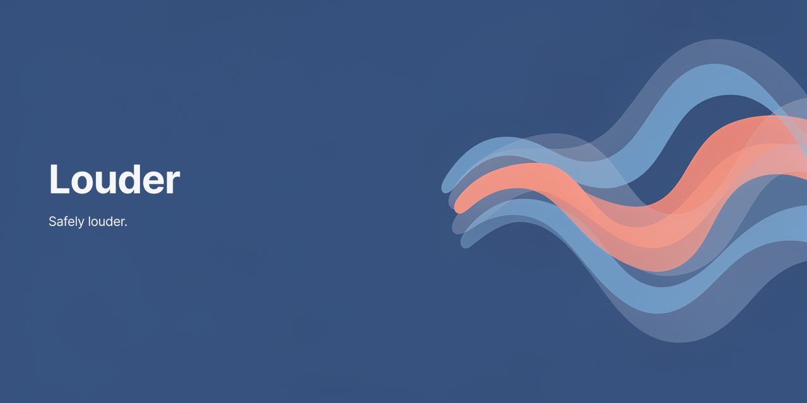
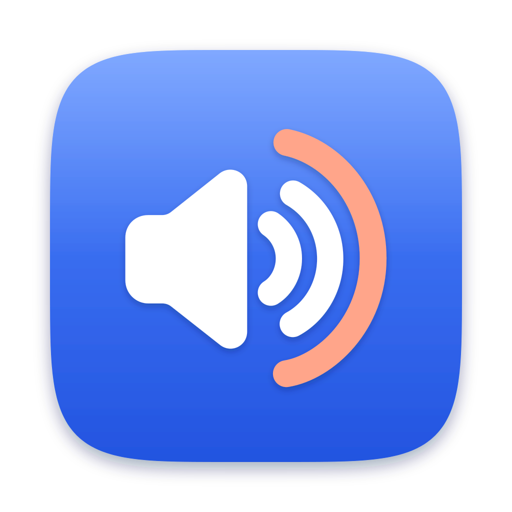

<p align="center">
  
</p>

<p align="center">
  
</p>

<h1 align="center">Louder</h1>

<p align="center"><strong>Safely louder.</strong><br>
A free, open-source menu bar app that boosts your Mac's volume past 100% and protects your ears while it does.</p>

<p align="center">macOS 15+ &middot; MIT licensed &middot; no drivers, no kernel extensions, nothing leaves your Mac</p>

> [!WARNING]
> Loud sound can permanently damage your hearing. Turn your system volume down before you turn Louder on, and read [Hearing safety](#hearing-safety) before you use it with headphones.

## Why

Some videos, calls and podcasts are quiet even with the volume all the way up. Louder gives you extra headroom when you need it. A limiter and a loudness guard are part of the feature: quiet content gets the full boost, and already-loud music barely moves.

## Features

- Menu bar toggle and a boost slider in 1 dB steps
- Per-device caps: +6 dB for headphones and unrecognized devices, +12 dB for speakers
- Loudness guard that backs the boost off for content that is already loud
- Peak limiter with a hard -1 dBFS ceiling
- Gentle ramping: boost always eases in from 0 dB
- Output picker: follow the system output or pin a specific device
- Launch at login
- Fails open: when Louder turns off, crashes, or loses its device, normal audio comes back

## Hearing safety

Louder makes things louder. Please treat it with respect.

**What protects you**

- **Caps.** Louder picks a safety profile for the output device and shows it in the panel as **Headphones** or **Speakers**.
  - **Headphones, +6 dB:** every Bluetooth device (AirPods, Bluetooth speakers too); any device whose name contains headphone, AirPods, buds, headset or earphone; the built-in output unless its source is the internal speakers; and any device Louder cannot recognize, which includes most USB devices.
  - **Speakers, +12 dB:** the Mac's internal speakers, HDMI, DisplayPort and AirPlay outputs, and wired devices whose name contains speaker or display.

  The choice is based on the device name and connection type, so it can be wrong. If the panel says **Speakers** while you are wearing headphones, keep the boost low.
- **Loudness guard.** Louder lowers the boost so that the content's short-term loudness plus the boost stays under a ceiling (-14 dBFS RMS on headphones, -10 dBFS RMS on speakers). Quiet content gets the full boost; loud content gets little or none.
- **Peak limiter.** Every output sample stays at or below -1 dBFS.
- **Ramping.** Boost always starts from 0 dB and rises at most 3 dB per second, so +12 dB takes at least 4 seconds to reach. It drops instantly when audio gets louder, and it never grows during silence, so sound that starts after a pause isn't hit by extra boost.
- **Feedback trip.** If the incoming audio level stays above -4 dBFS for 0.3 seconds, Louder treats it as feedback and turns itself off.
- **Fail open.** If the output device disconnects or changes, its sample rate or channel layout changes, or audio stops flowing, Louder lets go and normal audio returns immediately. It then reconnects and eases back in from 0 dB. After more than 5 restarts in 30 seconds it stays off. The original audio is muted only while Louder is actively reading it, so if Louder crashes or is force-quit, normal audio returns.
- **One at a time.** Only one copy of Louder (the app or `louder-cli`) can boost at once, so two copies can never boost each other.

**What does not protect you**

The caps and ceilings are digital levels. How loud that is depends on your system volume, your speakers or headphones, and how close they are to your ears. Louder cannot measure that, and it cannot know how long you have been listening. Boosted sound can still be too loud for you.

**What we suggest**

1. Start with a low system volume and a small boost.
2. Raise the system volume first, then add boost only if you still need it.
3. Keep headphones at a comfortable level. The lower headphone cap is there for a reason.
4. Take breaks from long listening sessions.
5. If anything sounds harsh or too loud, or your ears ring or feel muffled afterwards, turn Louder off.

## Install

### 1. One-line installer (recommended)

```sh
curl -fsSL https://raw.githubusercontent.com/luizParreira/louder/main/scripts/install.sh | bash
```

The script downloads `Louder.zip` from the latest release, checks its SHA-256 checksum, installs Louder in `/Applications` (or `~/Applications` if `/Applications` is not writable) and opens it. Because the download does not go through a browser, Gatekeeper does not block it. Read [`scripts/install.sh`](scripts/install.sh) first if you like.

To install a specific release, set `LOUDER_VERSION` to its tag:

```sh
curl -fsSL https://raw.githubusercontent.com/luizParreira/louder/main/scripts/install.sh | LOUDER_VERSION=v1.0.0 bash
```

### 2. Download from Releases

Download the DMG or zip from [Releases](https://github.com/luizParreira/louder/releases) and move Louder to Applications.

Louder builds are ad-hoc signed (no Apple Developer ID) and not notarized, so macOS blocks the first launch of a browser download. To allow it:

1. Open Louder once and click **Done** on the warning.
2. Open **System Settings > Privacy & Security**, scroll down to **Security**, and click **Open Anyway** next to the message about Louder.
3. Confirm with your password or Touch ID.

Or remove the quarantine flag in Terminal:

```sh
xattr -dr com.apple.quarantine /Applications/Louder.app
```

### 3. Build from source

```sh
git clone https://github.com/luizParreira/louder.git
cd louder
make install
```

`make install` builds `build/Louder.app` and copies it to `/Applications`. Run `make` to see the other targets.

## Requirements

- macOS 15 or later
- Apple silicon or Intel
- For building: the Xcode toolchain (Swift 6)

## First run and permission

Louder uses Core Audio process taps, which need the **System Audio Recording** permission. macOS asks the first time you turn Louder on. You can change it later in **System Settings > Privacy & Security > Screen & System Audio Recording**.

If you deny it, Louder stays off and shows **Needs permission**, with buttons to open System Settings and to try again. Your normal audio keeps playing.

If Louder is on but you hear nothing at all, the permission is probably missing or was removed: without it the tap receives only silence. Turn Louder off or quit it and sound returns, then check the setting.

## Usage

1. Click the Louder icon in the menu bar.
2. Under **Output**, keep **Follow system output** or pick a specific device. If a device you picked is not connected, Louder stays off and says so; it never moves the boost to a different device on its own. The panel shows the device in use and whether Louder treats it as **Headphones** or **Speakers**.
3. Turn Louder on with the switch.
4. Drag the **Boost** slider. It goes up to the cap for the current device, and the boost eases in gradually.
5. Optionally turn on **Launch at login**.

The status line shows what Louder is doing: easing in, boosting, or holding back because the audio is already loud. A second line shows when the limiter is catching peaks.

Louder remembers your boost, your output choice and whether it was on. If it was on when you quit, it turns on again the next time it launches, including at login. It turns off before your Mac sleeps and turns back on shortly after it wakes. Each time, the boost starts from 0 dB. When Louder turns itself off (a safety stop, an error, or a missing permission), it stays off until you turn it on again.

## Troubleshooting

- **No sound after turning Louder on.** Turn Louder off, then check the System Audio Recording permission (see above).
- **Sound is stuck muted.** Turn Louder off with the switch, or click **Quit Louder** in the panel (⌘Q). If it will not quit, run `pkill -9 Louder` in Terminal. That restores normal audio.
- **The boost seems small.** The content may already be loud, so the loudness guard holds it back (the status line says "Holding back"). On headphones the cap is +6 dB.
- **macOS asks for permission again after an update.** Builds are ad-hoc signed, so macOS can treat each update as a new app. Grant the permission again.
- **Louder turned itself off.** The panel shows **Louder stopped** and the reason, such as detected feedback or too many restarts in a short time. Check your audio routing, then click **Turn On Again**.

## Command line

The repository also builds `louder-cli`, a small terminal front end to the same engine:

```sh
swift build -c release --product louder-cli
.build/release/louder-cli --list          # output devices and their safety profile
.build/release/louder-cli --boost 3       # boost; type + / - then Return, q to quit
.build/release/louder-cli --selftest      # inaudible check that capture works on this Mac
```

Run it in Terminal.app. Ctrl-C stops it and restores normal audio; a second Ctrl-C exits immediately.

## How it works

Louder uses a Core Audio process tap to capture the audio going to your chosen output device, mutes the original only while the tap exists, applies the boost, and plays it to the same device through a private aggregate device. There is no kernel extension, no virtual audio driver, and nothing leaves your Mac. More detail in [docs/how-it-works.md](docs/how-it-works.md).

## Uninstall

```sh
curl -fsSL https://raw.githubusercontent.com/luizParreira/louder/main/scripts/uninstall.sh | bash
```

or, from a clone, run [`scripts/uninstall.sh`](scripts/uninstall.sh). It quits Louder, deletes `Louder.app` from `/Applications` and `~/Applications`, removes its preferences, and prints how to reset the System Audio Recording permission.

## Contributing

Bug reports and pull requests are welcome. Read [CONTRIBUTING.md](CONTRIBUTING.md) first; changes to the safety code have extra rules.

## License

[MIT](LICENSE) &copy; 2026 Luiz Parreira
